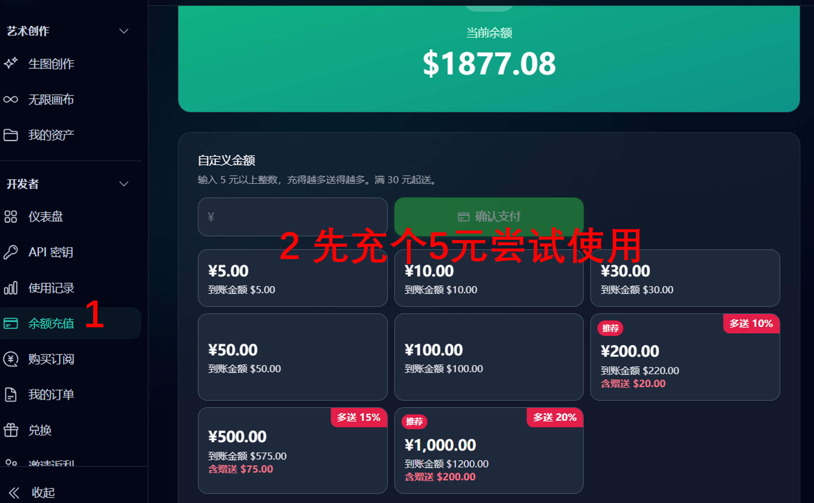
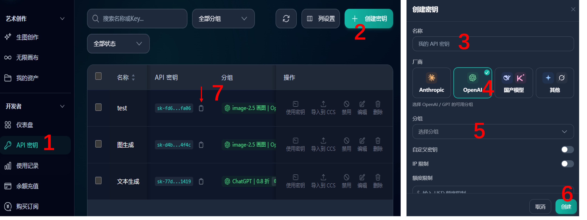

# image-gen：图片生成 技能

## 是什么

`image-gen` 是一个通过配置的图片服务接口生成图片的技能。用自然语言描述想画什么，或提供参考图，就可以生成图片、保存到本地，并在对话中查看结果。支持设置清晰度、画质档位、画面比例和生成张数。

## 技能安装

按所用平台的技能安装方式操作，可尝试以下方式：

- **放入技能目录**：在 Codex、WorkBuddy、Trae 等支持本地技能的平台，将完整的技能文件夹命名为 `image-gen` 后放到对应技能目录，具体位置以平台设置为准。Codex 的 Windows 默认位置为 `C:\Users\用户名\.codex\skills\image-gen`，将“用户名”替换为自己的 Windows 用户名。
- **让智能体协助安装**：将技能压缩包交给智能体，告诉它：“请将这个技能安装到当前平台的技能目录”，平台需支持读取压缩包和操作本地文件。

安装后的 `image-gen` 文件夹内应直接包含 `SKILL.md`、`README.md`、`scripts`、`agents` 和 `assets`；请保留完整文件夹。

备注：建议使用 Node.js 22 或更新版本，需要支持 `fetch`、`FormData` 和 `Blob`，无需额外安装 npm 依赖。

## 首次配置

1. **注册账号**：打开作者推荐的链接完成注册（已有账号可以直接登录）；

   https://code.heihuzi.ai/register?aff=L5JCRAHZ4BGQ

2. **首充尝试**：建议先充值 **5 元**，少量体验生图效果和使用流程；如果不合适，及时止损。充值入口和金额以平台当前页面为准。

   

3. **获取 API Key**：登录服务平台，进入“API 密钥”，点击“创建密钥”，填写名称，选择“OpenAI”和支持图片生成的分组，点击“创建”，然后复制生成的 API 密钥。操作顺序见下图，具体以当前页面为准。

   

4. **复制配置模板**：打开技能的 `scripts` 文件夹，将 `.env.example` 复制一份，重命名为 `.env`。已有 `.env` 时直接编辑，不要覆盖。

5. **编辑 `.env`**：模板已预填接口地址，只需将自己的 API Key 填在 `GPT_IMAGE2_API_KEY=` 后面并保存。若使用其他兼容服务，再修改 `GPT_IMAGE2_BASE_URL`。其余参数可按需调整，单次画图要求会覆盖对应默认设置，不必每次修改 `.env`。

   ```dotenv
   GPT_IMAGE2_API_KEY=你的API密钥
   ```

技能安装后，没有配置 API Key 时，智能体会给出注册和配置步骤；支持打开本地文档的平台也会展示这份说明。

## 参数含义

| 参数 | 含义 |
| --- | --- |
| `GPT_IMAGE2_BASE_URL` | 画图服务 API 基础地址，模板已填 `https://code.heihuzi.ai/`；不是注册链接 |
| `GPT_IMAGE2_API_KEY` | 你的 API 密钥，必须填写 |
| `GPT_IMAGE2_MODEL` | 默认模型：`gpt-image-2.5-flare`；可改为更精细的 `gpt-image-2.5-sunburst`，或旧模型 `gpt-image-2` |
| `GPT_IMAGE2_MODE` | 请求模式，日常保持 `current`；`official-compatible` 用于兼容接口测试 |
| `GPT_IMAGE2_N` | 默认生成张数，`1` 表示一张 |
| `GPT_IMAGE2_RESOLUTION` | 清晰度档位：`1k`、`2k`、`4k` |
| `GPT_IMAGE2_ASPECT_RATIO` | 宽高比：`1:1` 方图、`16:9` 横图、`9:16` 竖图，也支持 `3:4` 等比例 |
| `GPT_IMAGE2_QUALITY` | 质量：`auto`、`low`、`medium`、`high`；flare/sunburst 还支持 `xhigh`、`max`。模板为 `LOW`，脚本会按 `low` 处理；`current` 模式留空也为 `low` |
| `GPT_IMAGE2_BACKGROUND` | 背景：`auto` 自动、`opaque` 不透明、`transparent` 透明；留空不指定 |
| `GPT_IMAGE2_OUTPUT_FORMAT` | 文件格式：`png`、`jpeg`、`webp`；模板默认为 `png`，留空由服务决定 |
| `GPT_IMAGE2_OUTPUT_COMPRESSION` | JPEG/WebP 压缩质量参数，范围 `0–100`；PNG 不使用，通常留空 |
| `GPT_IMAGE2_MODERATION` | 审核档位：`auto` 或 `low`；留空使用服务默认 |
| `GPT_IMAGE2_OUT_DIR` | 保存目录，默认 `./image2_output`，相对于运行时工作目录；可填 `F:/images/generated` 等绝对路径 |
| `GPT_IMAGE2_TIMEOUT_MS` | 单位毫秒；`240000` 为 4 分钟。生成阶段（含排队与重试）共用一次额度；全部图片下载再共用一次额度，费用查询还可能额外等待最多约 8 秒 |
| `GPT_IMAGE2_MAX_RETRIES` | 仅对可重试的 429 限流错误重试；默认 `2`，即首次请求后最多再试两次。余额不足、超时和 5xx 错误不会自动重试 |
| `GPT_IMAGE2_MIN_INTERVAL_MS` | 本机相同服务和密钥的请求启动间隔，单位毫秒；`0` 不限制，`5000` 为 5 秒 |
| `GPT_IMAGE2_SHOW_COST` | `false` 不显示生成摘要；`true` 显示模型、尺寸、质量、token 和可查到的实际费用 |
| `GPT_IMAGE2_COST_LOOKUP_CLI` | 可选配套费用查询工具的路径，需有相应权限；留空时不自动寻找其他技能，没有可用工具时费用显示“暂未查到” |

## 怎么使用

配置完成后，调用技能并输入画图要求。

**普通画图：**

```text
$image-gen 画一张国风女孩头像，方图，默认配置。
```

**指定比例、清晰度和张数：**

```text
$image-gen 画赛博朋克雨夜街头，横版 16:9，2K，高质量，生成 2 张。
```

**使用参考图：**

```text
$image-gen 参考“F:\images\reference.png”的配色和画风，生成一张春季海报，竖版 3:4，2K。
```

**更精细的模型与透明背景：**

```text
$image-gen 用 sunburst 画一个绿色叶片图标，透明背景，PNG，方图。
```

**指定保存位置：**

```text
$image-gen 画一张山水插画，16:9，2K，保存到“F:\images\generated”。
```
